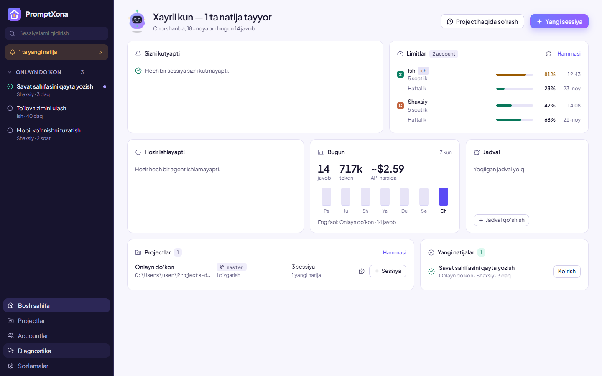
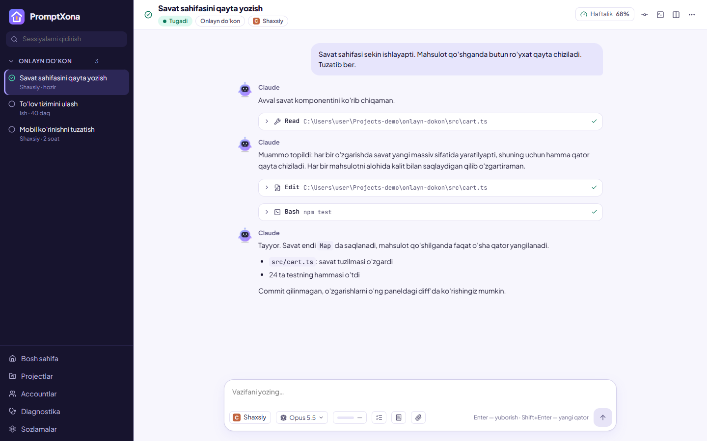
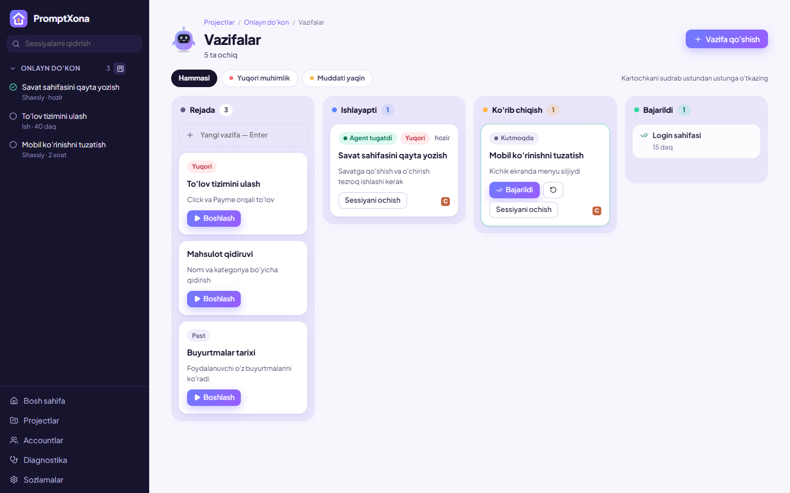

# PromptXona

Claude Code va Codex agentlari uchun Windows boshqaruv markazi.

## Yuklab olish

**[⬇ PromptXona'ning so'nggi versiyasini yuklab olish](https://github.com/Botirbek/promptxona-releases/releases/latest)**

Sahifadagi `PromptXona-Setup-<versiya>.exe` faylini yuklab oling va ishga tushiring.

- **Windows 10/11, 64-bit.** Administrator huquqi kerak emas.
- **"Windows protected your PC" chiqsa,** **More info → Run anyway** bosing. Installer hali raqamli imzoga ega emas.
- **Claude Code** alohida o'rnatiladi: https://claude.com/claude-code. Codex esa installer ichida keladi.
- **Yangilanishlar avtomatik.** PromptXona yangi versiyani o'zi topadi va orqa fonda yuklab oladi.

## Ko'rinishi

**Chat.** Agent nima o'qigani, nimani o'zgartirgani va qaysi buyruqni ishga tushirgani bitta oqimda ko'rinadi.

**Vazifalar.** Har bir loyihada kanban: vazifadan bir bosishda agent sessiyasi ochiladi, holati kartochkada ko'rinadi.

